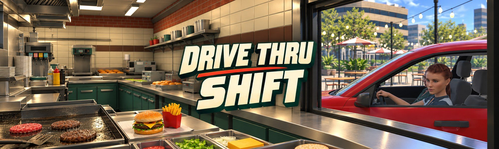
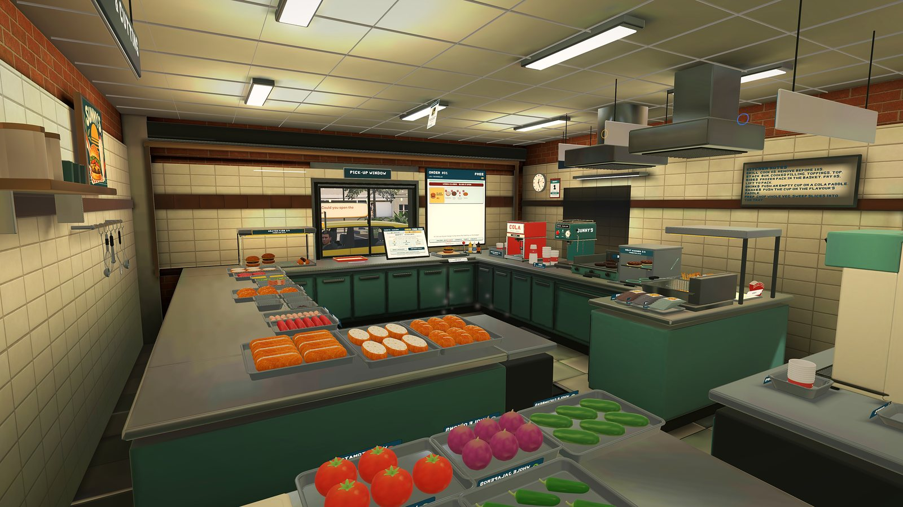
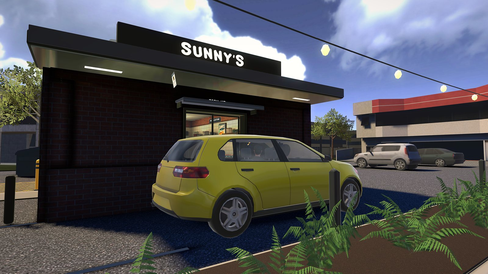
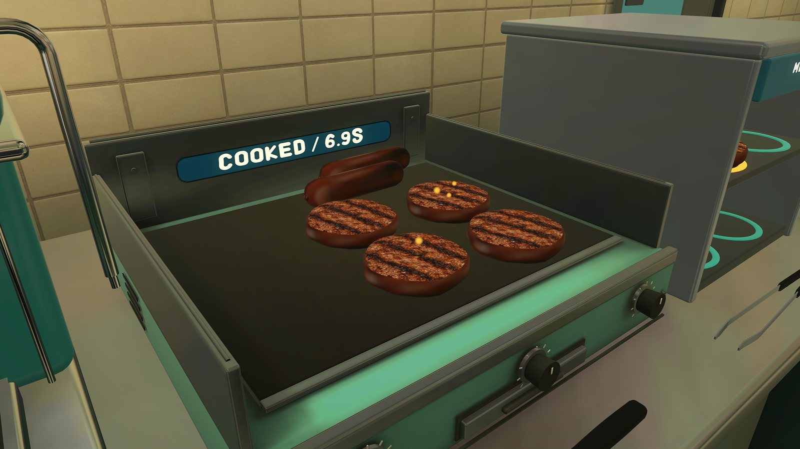
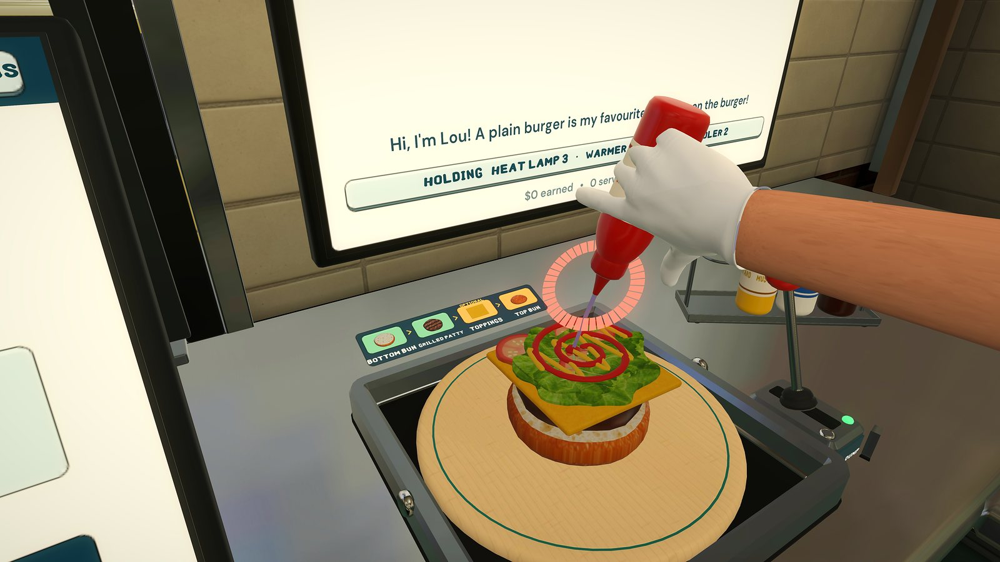

# 🍔 Drive Thru Shift VR

**Current Status:** Coming soon to Meta Quest
**Platform:** Meta Quest 2, Quest 3 and Quest Pro

> *"The grill is hot, the fryer is bubbling and the first car is already at the window."*

## 🎮 About The Game
**Drive Thru Shift VR** puts you behind the counter of Sunny's, a busy roadside diner. Every car brings a new order, and it's up to you to cook it, build it and hand it through the window before the driver gives up and leaves.

Fast, correct orders earn tips. Spend them between shifts on new dishes, toppings and machines, and grow Sunny's from a burger stand into a full menu.

### ✨ Key Features
* **Hands-on Cooking:** Grill patties and sausages, drop fries, nuggets and onion rings, and slice fresh toppings.
* **Build Every Order:** Stack burgers, hot dogs and custom subs on the prep board.
* **Trigger-Pressure Sauces:** Squeeze ketchup, mustard, mayo and BBQ. Squeeze harder for more, but too much gets messy.
* **Drinks and Desserts:** Pour colas, pull coffee, swirl soft serve, mix shakes, bake cookies and toast bagels.
* **Grow the Diner:** Unlock new dishes and machines one shift at a time.
* **Learn As You Go:** A hands-on tutorial for every station, plus a Practice mode with no clock.

## 🖼 Screenshots
| | |
|---|---|
|  |  |
|  |  |

## 🛠 Technical Info
* **Engine:** Unity
* **Platform:** Meta Quest (standalone VR)
* **Input:** 6DOF Touch controllers
* **Players:** Single player

* **Website:** open `index.html` (published with GitHub Pages)
* **Privacy Policy:** [privacy.html](privacy.html)
* **Support:** Rushgear49@gmail.com

---
*Developed by SerenadeVRStudios*
